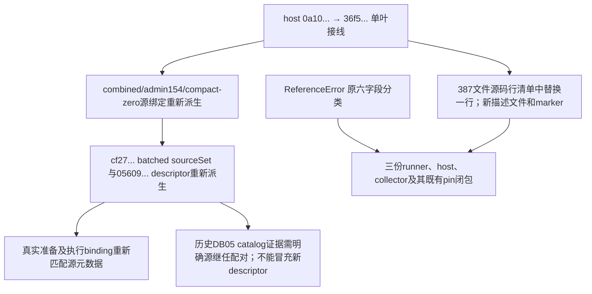

# PREPARE04 词法作用域修正与 UNKNOWN 分类候选

已确认源码存在两个跨函数未声明引用；修正候选仅更正接线和 ReferenceError 分类。真实 04 失败的原始异常未保留，不能把本项静态缺陷称为已捕获的现场根因。本目录是独立源码候选，未修改 ROOT06、NORMAL38、846 归档准入或既有复核。没有服务器、PG、原生准备、签发、时钟、未来服务、重放或全量编译操作。

## 实际证据和结论边界

T45 的 ACTUAL-PREPARE04-FAILED-RESULT.json SHA256 为 `6cdb346addd81ae0725756e36b745e47f863eb21589b91fdd58d41ab934e9655`，原 native-result SHA256 为 `58b7a16f6845dd552476a960c875c64b9d3b7e4e34a095ce9f2e234ce6a080a4`。ACTUAL-NATIVE58B7-SAFE-PROJECTION.json SHA256 为 `95b55c81902973c71aeb936bf76f3caeab2882b1ce0b656a700aa4622c14c19f`。

原生 producer 已输出 PREPARE_CALL / UNKNOWN / UNKNOWN / UNKNOWN / sqlstate=null，host 和 collector 并未把已识别类型过滤成 UNKNOWN。原生 nativeResult、preparedBinding、executionBinding、hostVerification 字段实际不存在，connectionCleanup=UNKNOWN。过程回收 REAPED_EXCLUSIVE_PROCESS 不能改写成原生 CLOSED；安全投影自身 PGConnections=0 仅说明该次只读采集，不证明失败准备从未建立 PG 连接。

## 确定源码缺陷

以下行号均指冻结 `outputs/D1/20261116-r3-final-source-prepare-01/work/` 的原文件：

- `tools/unified-import/fresh35-host-session.mjs:995–1017` 的 readFresh35BatchedContextInputs 在 1011 将两个 builder 动态解构为函数局部常量。模块顶部没有对应绑定。
- 同文件另一个函数 loadFresh35BatchedImportContext 在 1065、1066 直接调用 buildFresh35BatchedCatalogV1、buildFresh35BatchedCommandSuccessorCatalogV1。没有合法词法绑定；到达第一处将触发 ReferenceError。不能以另一函数早先成功调用来授权跨作用域使用。
- `whole-host-session.mjs:241` 等待上述 context，256–260 才装载物理驱动并连接 PG，267 才调用 prepare 回调。因此**此确定缺陷**位于接线/上下文准备分支，早于该 factory 的 PG 连接、SQLite 批计划和业务 writer；这不是“已证明本次现场未连接”的断言。
- 当前 runner `final33-run.mjs:16–24` 的 describeFailure 缺少 ReferenceError。ReferenceError 不属于现列 AssertionError/TypeError/RangeError/SyntaxError，原型也不是 Error.prototype，故类型退回 UNKNOWN。它通常没有 own code，未列固定 guard 的 message 也退回 UNKNOWN；该路径与真实六字段相符，但没有反推原始 throw 的唯一性。

## 原始 PREPARE_CALL 的分支与异常传播

| 顺序 | 冻结源码位置 | 可失败边界与诊断影响 |
|---|---|---|
| 1 | retained-import:30–43 | 源/输入绑定、plan 路径 lstat；正常 Error guard 不在 FINAL33 列表时只丢 guard，类型仍应为 Error；C05 已修复且有实际搜索证明，不能新猜 EACCES |
| 2 | retained-import:48 → whole-host:241 → fresh35-host:995–1078 | FS/受保护输入、源文件闭包、目录模型及 authority/context；确定未声明引用在1065/1066，先于 factory connect |
| 3 | whole-host:256–260、360起 | 固定 Linux pg 文件/父目录验证、driver import、connect；connect catch 将底层连接异常改为 WHOLE_CONNECTION_FAILED/CLEANUP_FAILED Error，原 code 丢失 |
| 4 | whole-host:128–190、fresh35-host:150–176 | 同一物理连接上的只读 catalog BEGIN/guards/observation/ROLLBACK；catalogFailureError 在48包装成 Error，并保存私有 catalogFailure；runner不读取该私有对象，guard/SQLSTATE仅允许既有闭合值 |
| 5 | retained-import:49–55、stream-plan:20起 | 已准入后，验证 index、SQLite只读索引、私有临时图、汇总和编译原程序；其下层 guard 不在 runner FINAL33 guard 列表；SQLite 等未列 system code 仍过滤 UNKNOWN，不新增任意透传 |
| 6 | batched-stream-cli-state:103–110 → batched-stream-plan:12起 | 独占创建 plan、SQLite事务持久化原请求、关闭重开、精确绑定校验；工作没有在这里执行业务 writer |
| 7 | retained-import:56–79、whole-host:269–282 | private initializer、prepared binding/root inspect、PREPARE_ONLY 返回；finally清理异常可覆盖先前异常，未成功返回不能推定 CLOSED |
| 8 | runner:214–217 → final33_host.py:597–605 → read_pending38.py 内嵌 project_failure_diagnostic | 原错误对象只在 runner catch 投影为六字段；host及collector严格校验同一个六字段集合后复制。原 stderr 在host:403/466丢弃，本证据无原始throw，不导出message/stack/path |

三类假设的区分结果：漏 ReferenceError 分类和两处作用域缺陷已由源码确认；现有系统码/guard/SQLSTATE白名单也确实有意丢弃未列值；仅从实际六字段无法证明 SQLite、PG 或 FS 发生过哪一种错误。catalog包装及连接包装另有信息损失，但不是“host/collector把已知类型丢掉”。

## 最小变更

1. `source/tools/unified-import/fresh35-host-session.mjs`：将同一既有 catalog 模块的两个 builder 加入现有模块级 named import，删除 readFresh35BatchedContextInputs 中那一句局部动态解构。两个函数的业务调用次序、参数、SQL、prepare-only、原API和finally均不变。同一个 catalog 模块本来已静态导入，不引入新模块依赖。
2. `diagnostic/final33-run.mjs`：仅在原 describeFailure 类型分支增加 ReferenceError，不加字段，不扩展 code/guard/sqlstate，不采 message/stack/path。
3. `diagnostic/final33_host.py` 和 `diagnostic/read_pending38.py`：仅在现有 errorType 闭合列表加入 ReferenceError，避免 producer新分类被外层拒绝。collector内嵌程序同步。没有引入新错误平台。

诊断给的是当前 representative prepare bundle 的独立候选。T45 若装配，必须在 prepare/writer/readback 三份同源 runner及相应host投影同步新叶和pins；不能把本目录文件直接塞进已冻结 fb8f 清单或声称完成新闭包。`MINIMAL-NOT-APPLIED.patch` 未应用到原树。

## 影响图和部署约束

| 范围 | 必要影响与未完成项 |
|---|---|
| 应用源码 | 仅一个 runtime host 叶发生实现差异；其余7个检查模块不改；新增依赖路径为0 |
| ROOT06 d20f9f89... | 已完成的387文件物料、078f2c00...行清单、73ec88d3...实际结果全部保留，不能就地覆盖或重放原key。继任物料仍387路径，替换host的一行摘要和大小，重新生成源描述/完整行清单/新marker及consumer引用。此候选不伪造任何完成marker |
| 源集合派生 | 原source loader把host纳入 currentSourcePins/currentSourceDelta，多层 sourceSet 是含前代的结构摘要。d20...和cf27...不能沿用为已修改源码的摘要。仅把284末级pins替换后直接hash不等于原多层算法 |
| catalog | 原 cf27add8653a4aa85b8cb10d609e2b85b1c4e55cf02f7fd2f5bf9e60ecb5ce9c sourceSet、05609b8c0eb2b4be1fb84e2e3ef1d8b1737f82afe712cd49cd111860e22675bb descriptor含源绑定；observation SQL也嵌sourceSet，因此新元数据摘要须按真实源派生。未生成该派生值，绝不拿旧值标新PASS |
| 数据库实体 | 本补丁未改SQL文件、35表、161函数body/definition/model输入或权限。已知 model626c5604...输入保持原字节，无源码理由要求DDL/业务数据重装。目录描述/观察SQL源标记改变不等于实体模型改变；尚未实测新live catalog |
| DB05旧收据 | final33_host.py:240–247明确要求旧实际batchedCatalog等于新authority.expectedBinding。若新binding采用新sourceSet/descriptor，直接复用历史cf27收据会拒绝。需要owner明确的源码继任元数据配对方案，不能覆盖历史收据、放宽比较或为凑证据重放旧catalog job。此处只报告影响，不实现新准入路径 |
| 权限与时间 | 没有新角色/C/epoch/key/未来许可或receipt。本目录所有未实际派生、未安装和未执行值均为空/未验证 |

## 有限验证

`node outputs/D1/20261117-r3-prepare04-lexical-fix-source-01/check_scope.mjs` 已执行。TypeScript 对8个真实受影响模块及host候选只做 parse/bind、noResolve/noEmit，筛查未声明标识符诊断2304/2552/18004：原host恰有1065/1066两处，候选0，其余7模块0。没有运行这些应用模块或构造假target/cap/异常。

两份候选mjs语法检查、两份Python AST及collector内嵌程序AST通过；诊断runner其他函数逐字相同，两个Python变更只增加一项枚举。检查不是完整类型验收或真实准备PASS。不运行sealed18同目标、不做完整批编译、PG或现场复验。

有限尚未验证：原始现场throw；新源集合/目录描述派生值；新物料/marker/consumer包；历史DB05与新源元数据的合规继任配对；原QB对本候选的独立复核；真实准备与连接关闭、writer、读回和正式导入。归档登记仍停在此前保全WIP，846/7ecc冻结不改。
